# Coffee Shop Network (Cisco Packet Tracer)

A small network I designed and configured in Cisco Packet Tracer for a pretend coffee shop.

I built this to practice the **networking basics that IT operations and monitoring depend on**: VLANs, a router and switch, DHCP, and securing network devices. (My other lab, [NOC Monitoring Lab](https://github.com/Angad-Chahal/noc-monitoring-lab), covers monitoring and runbooks.)

**Status:** the switch and router are configured and checked. I still need to finish ACLs (network security rules) and test the end devices.

## What the coffee shop needs
- A **manager office** (PC and printer)
- A **point of sale (POS)** area (register and receipt printer)
- **Guest Wi-Fi** for customers
- A way for the owner to **manage the network devices** safely

The guest Wi-Fi should be kept separate from the register and the office, so I put each group on its own VLAN.

## The plan

| VLAN | Name | What it's for |
|---|---|---|
| 10 | MANAGEMENT_OFFICE | Manager PC and office printer |
| 20 | POS | Register and receipt printer |
| 30 | Guest_WIFI | Wi-Fi access point for customers |
| 99 | NETWORK_MANAGEMENT | Managing the switch and router |

**Devices:** 1 router (2911), 1 multilayer switch (3560), 1 wireless access point, a manager PC, a POS terminal, printers, and guest laptops. The router connects to a cloud that stands in for the internet provider (ISP).

## What I did

### 1. Layout and cabling
I placed the devices and connected them. I used specific switch ports on purpose, because in real networks every port is documented.

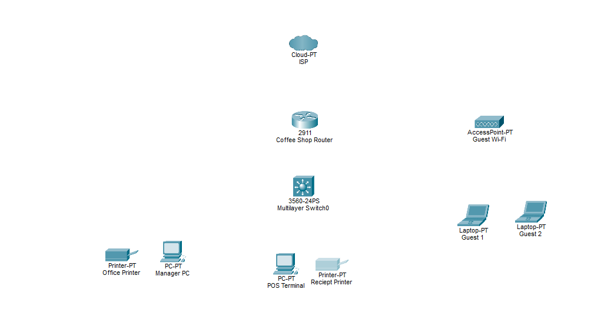
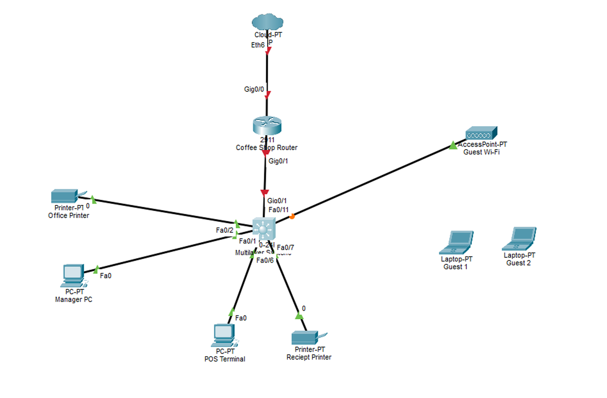

### 2. Secured the switch
- Named it `CoffeShop-SW`
- Turned off DNS lookup (stops slow typos)
- Set an enable secret password and password encryption
- Added a warning banner: "Unauthorized access is prohibited"
- Set a console password

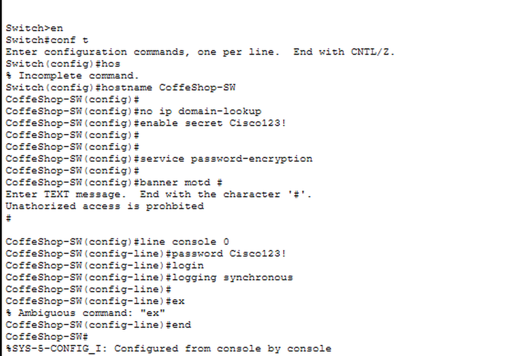

### 3. Created the VLANs
I split the network into VLANs 10, 20, 30, and 99 so each group is separate.

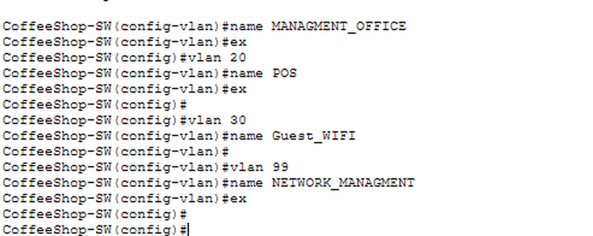

### 4. Assigned switch ports
I gave each port a description and put it in the right VLAN, with room left for growth. I turned on **PortFast** on ports that connect to end devices so they come up faster.

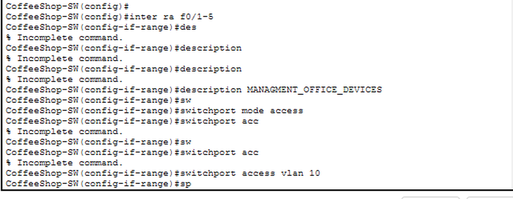
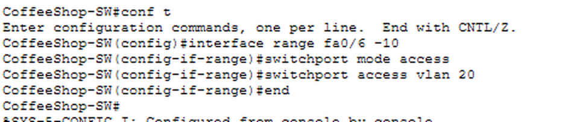
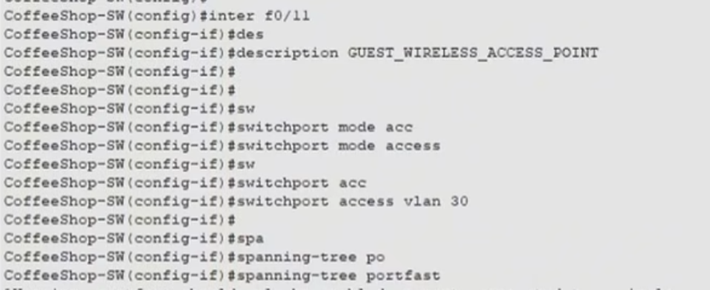

### 5. Connected the switch to the router
The router needs to carry all four VLANs, so I set up a **trunk** link between the switch and router that allows VLANs 10, 20, 30, and 99.

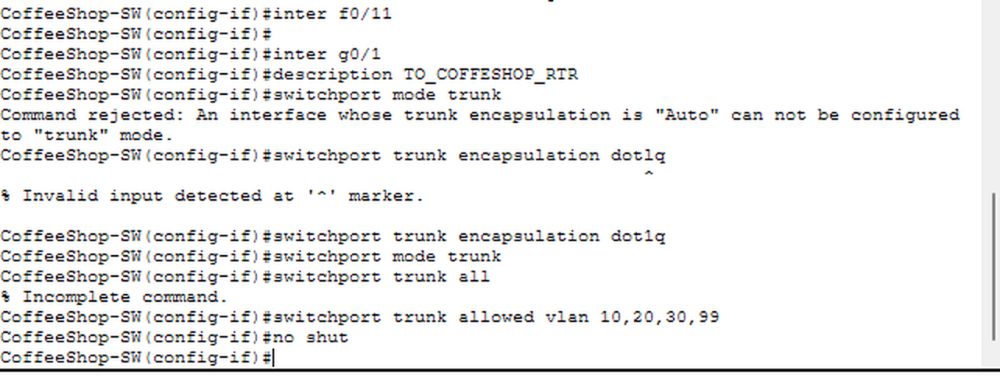

### 6. Switch management address and SSH
I gave the switch an address on VLAN 99 (for admins only, not for customers or employees) and set its default gateway. I also set up **SSH** so the switch can be managed remotely and securely, with an admin user and RSA keys.

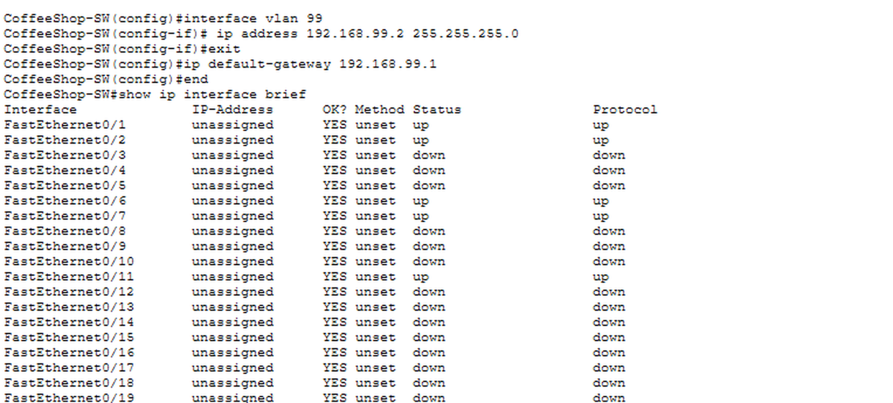
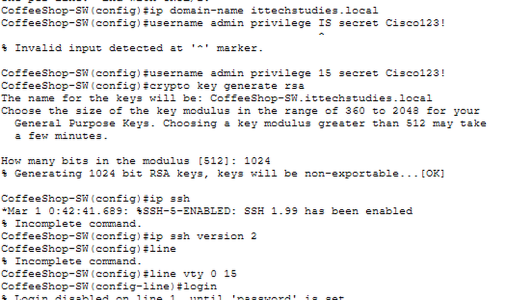

### 7. Checked my work on the switch
I used `show vlan brief` to confirm the VLANs and which ports are in each one.

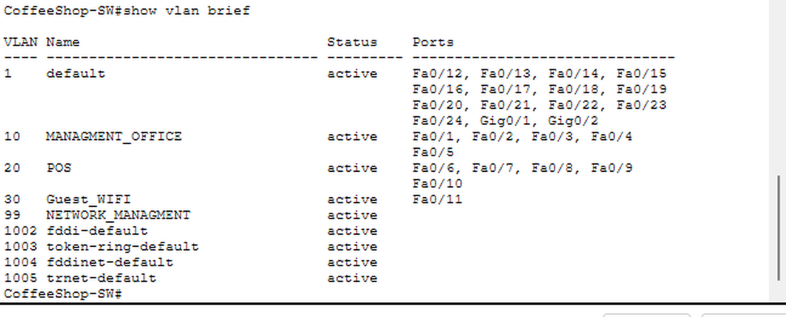

### 8. Set up the router
- Same basics as the switch (name, secret, banner, console password)
- Turned on the interface to the ISP and the interface to the switch
- Created a **sub-interface** for each VLAN (router-on-a-stick) so the VLANs can talk through the router. Each one is the default gateway for its VLAN.

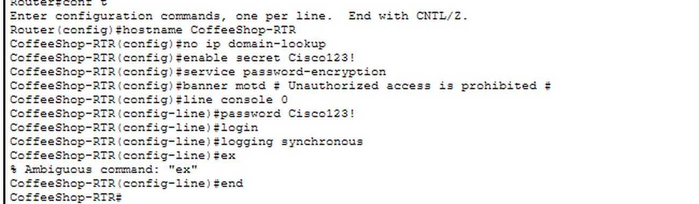
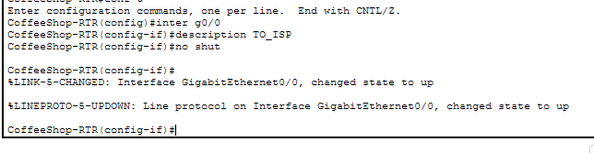
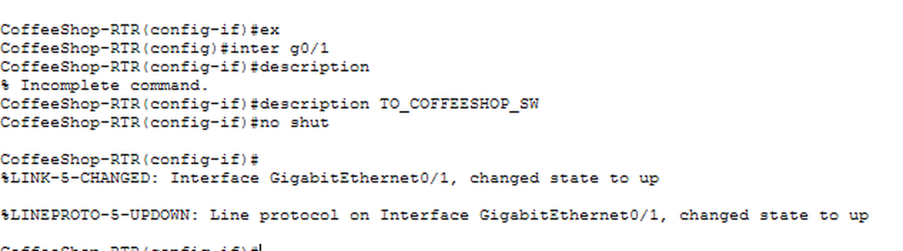

### 9. Set up DHCP
I set up a DHCP pool for each network so devices get an address automatically. I excluded the first 20 addresses in each range for devices that need fixed addresses. When a customer joins the guest Wi-Fi, the router gives them an address.

### 10. Found and fixed an addressing mistake
When I checked my work, I found two problems:
- I had typed **192.160.x.x** instead of the private range **192.168.x.x**.
- The router's management gateway did not match the gateway I set on the switch, so the switch could not reach it.

I changed the router sub-interfaces, the DHCP pools, and the switch management address to the correct 192.168 addresses, then checked everything again.

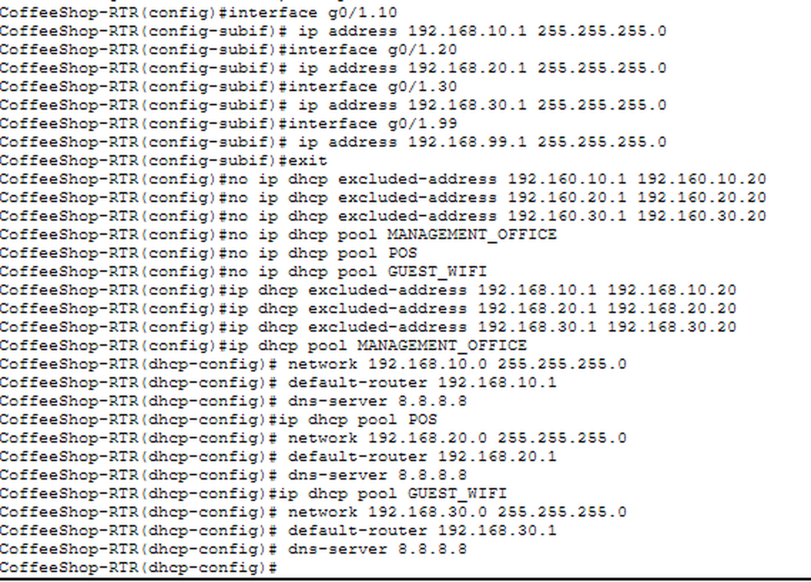

## Checked and working
- The router's sub-interfaces are all up, with the right addresses
- The three DHCP pools show the correct networks
- The switch management address (VLAN 99) is up
- The switch can ping the router's management gateway (4 of 5 replies; the first one times out while the address is learned, which is normal)

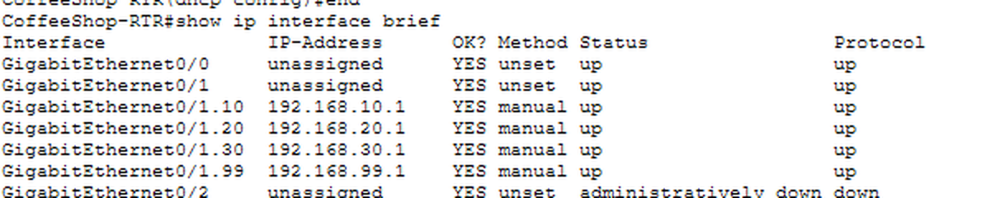
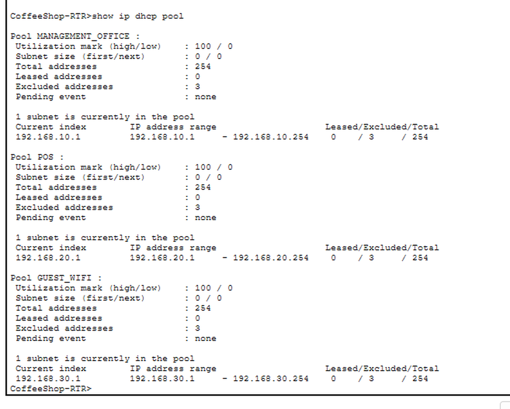
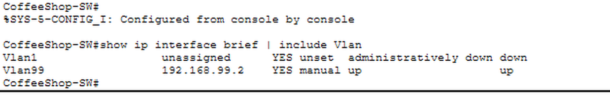
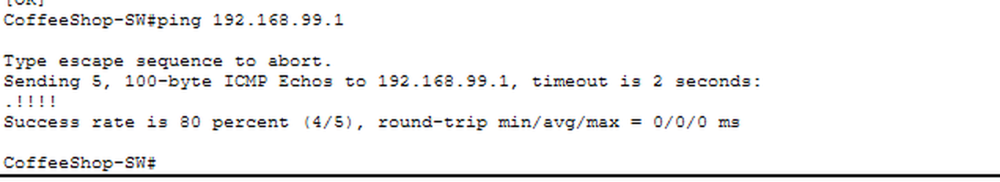

## What I learned
- Why networks are split into VLANs (keeping guests away from the register and office)
- How a router connects VLANs through sub-interfaces and a trunk
- How DHCP hands out addresses and why some addresses are reserved
- How to secure network devices with passwords, SSH, and a banner
- How to check my work with `show` commands, find a mistake (a wrong address range), and fix it
- To document every port

## What's left
- Add **ACLs** so guests can't reach the POS or the office
- Connect and test the end devices (the PCs, POS terminal, and guest laptops)
- Do final testing, such as pings between networks

## Tools
Cisco Packet Tracer, Cisco IOS command line
